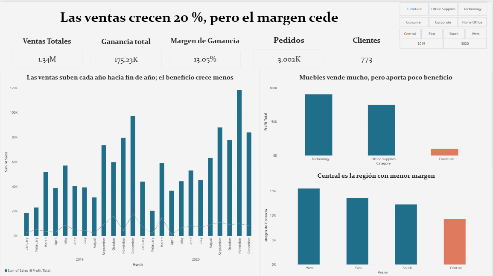
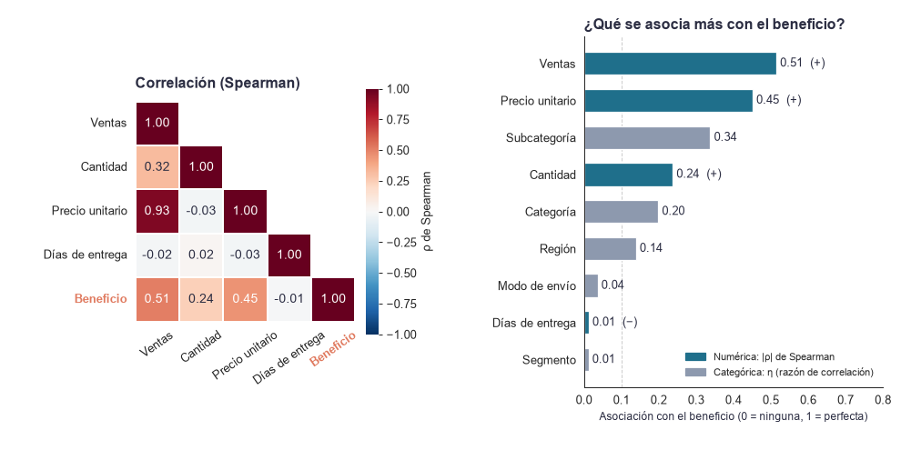
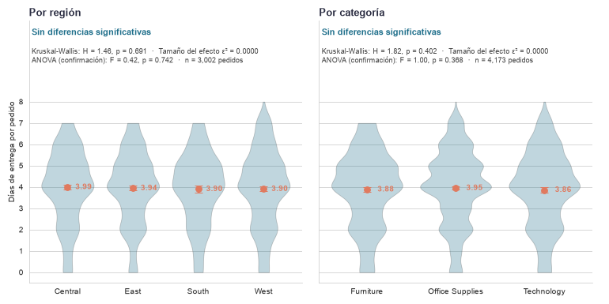
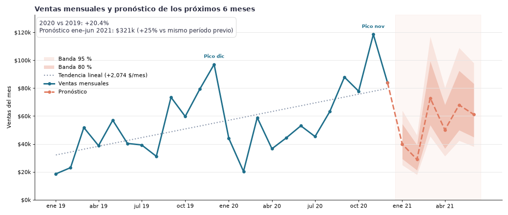

# Caso 3: Las ventas crecen 20 %, pero el margen cede

Integración de visualizaciones avanzadas generadas con Python en Power BI y desarrollo de un tablero interactivo mediante un relato visual, con el Superstore Dataset.

**Autora:** Daniela Mora

## Preguntas de investigación

1. ¿Qué variables presentan mayor correlación con el beneficio total?
2. ¿Existen diferencias significativas en la satisfacción del cliente según la región o categoría?
3. ¿Cómo se comportan las ventas a lo largo del tiempo y qué tendencia se observa para los próximos meses?

## Herramientas

- **Power BI Desktop:** Power Query, columnas calculadas, medidas DAX y dashboard
- **Python** dentro de Power BI: pandas, numpy, matplotlib, seaborn y scipy

## Visualizaciones con Python

| Visual | Pregunta | Método |
|---|---|---|
|  | 1 | Mapa de calor de correlación de Spearman y ranking de asociación con el beneficio |
|  | 2 | Gráficos de violín del tiempo de entrega por pedido, con Kruskal-Wallis y ANOVA |
|  | 3 | Serie mensual con tendencia y pronóstico a 6 meses con bandas del 80 % y 95 % |

## Contenido del repositorio

| Archivo | Descripción |
|---|---|
| `Caso3_DanielaMora.pdf` | Informe del caso |
| `Caso3_DanielaMora.pbix` | Archivo de Power BI con el modelo y el dashboard |
| `python/` | Scripts de los 3 visuales de Python |
| `dax/medidas.dax` | Las 7 medidas DAX del modelo |
| `datos/Superstore_Dataset.xlsx` | Datos originales (hojas Orders y Returns) |
| `imagenes/` | Visuales de Python y capturas de las 4 páginas del dashboard |

## Respuestas

- **Pregunta 1:** las variables más asociadas con el beneficio son las ventas (ρ = 0.51) y el precio unitario (ρ = 0.45), seguidas por la subcategoría y la cantidad. La logística y el segmento no se asocian con él.
- **Pregunta 2:** no existen diferencias significativas en el servicio de entrega, usado como indicador de satisfacción, ni por región (p = 0.69) ni por categoría (p = 0.40). Las diferencias provienen del modo de envío.
- **Pregunta 3:** las ventas crecen cerca de 20 % anual con un pico de fin de año, y para enero a junio de 2021 se espera aproximadamente $321 mil.
